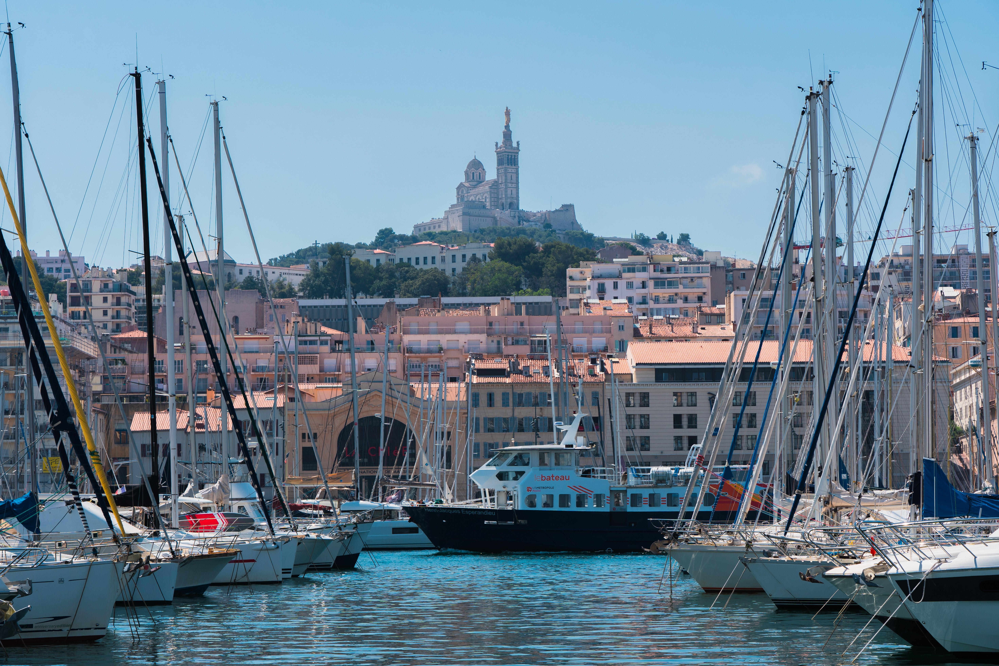

# MARSEILLE - LA CITÉ PHOCÉENNE

---

>Cette présentation de Marseille est faites par Adam Ferras et prouve son amour pour cette ville magnifique!

---

## Sommaire

### - Histoire et passé
   
   Découvrez la ville à travers le temps et plongez dans sa riche histoire, de sa fondation jusqu'à aujourd'hui, en passant par les grands événements qui ont marqué son évolution.
   
### - Culture et immigration
   
   Découvrez la richesse culturelle de Marseille et les différentes vagues d'immigration qui ont façonné son identité, ses traditions et sa diversité au fil du temps.
   
### - Tourisme et patrimoine

   Découvrez les lieux incontournables de Marseille, de ses monuments historiques à ses paysages magnifiques, en passant par ses quartiers emblématiques et ses célèbres calanques.
   
### - Faune et flore

   Découvrez la richesse naturelle de Marseille, sa faune et sa flore méditerranéennes, ainsi que les espaces naturels qui font de cette ville un lieu unique entre terre et mer.

Voici la liste de toutes les sources utilisées:

https://fr.wikipedia.org/wiki/Marseille

https://www.marseille.fr/index.php/decouvrir-marseille/2600-ans-dhistoire

https://musees.marseille.fr/le-port-antique

https://multimedia.inrap.fr/atlas/marseille/synthese-periodes/moyen-age

https://www.marseille-tourisme.com/decouvrez-marseille/culture-et-patrimoine/histoire-de-marseille/

# Histoire et passé

# Histoire et passé de Marseille

## Vers 600 av. J.-C. : la naissance de Marseille

Marseille est fondée par des marins grecs venus de Phocée, une ancienne cité située dans l'actuelle Turquie. À cette époque, la ville porte le nom de **Massalia**. Grâce à sa position près de la mer, elle devient rapidement un lieu important pour le commerce et les échanges avec les autres peuples méditerranéens.

[Source : Ville de Marseille](https://www.marseille.fr/index.php/decouvrir-marseille/2600-ans-dhistoire)

## 49 av. J.-C. : la conquête romaine

Marseille est conquise par Jules César après avoir soutenu son adversaire pendant la guerre civile romaine. La ville prend alors le nom latin de **Massilia**. Elle conserve son importance portuaire, même si sa situation politique change.

[Source : Musée d'Histoire de Marseille](https://musees.marseille.fr/le-port-antique)

## Le Moyen Âge : une ville qui évolue

Au Moyen Âge, Marseille traverse des périodes difficiles, notamment des conflits et des destructions. Au fil des siècles, la ville se développe à nouveau grâce au commerce et aux activités de son port. Elle reste un lieu important pour les échanges en Méditerranée.

[Source : Inrap](https://multimedia.inrap.fr/atlas/marseille/synthese-periodes/moyen-age)

## 1481 : Marseille rejoint le royaume de France

À la fin du XVe siècle, Marseille est rattachée au royaume de France avec la Provence. Ce rattachement marque une nouvelle étape dans son histoire et renforce progressivement ses liens avec le pouvoir royal français.

[Source : Ville de Marseille](https://www.marseille.fr/index.php/decouvrir-marseille/2600-ans-dhistoire)

## Le XIXe siècle : le développement du port

Au XIXe siècle, Marseille connaît une forte croissance. Son port se développe, les chemins de fer arrivent et de nouvelles industries apparaissent. De nombreuses personnes venues d'autres régions et de pays voisins s'installent dans la ville pour travailler. Marseille devient alors une grande ville commerciale et industrielle.

[Source : Ville de Marseille](https://www.marseille.fr/index.php/decouvrir-marseille/2600-ans-dhistoire)

## Le XXe siècle : une ville transformée

Au XXe siècle, Marseille traverse des périodes difficiles, notamment pendant les deux guerres mondiales. La ville connaît aussi des transformations importantes, avec la reconstruction de certains quartiers, le développement des transports et l'évolution de son port. Les arrivées de populations venues de différents pays contribuent également à façonner son identité.

[Source : Musée d'Histoire de Marseille](https://musee-histoire.marseille.fr/index.php/ressources/fiches-ressources-chronologiques-par-sequences)

## Marseille aujourd'hui

Aujourd'hui, Marseille est une grande ville française située au bord de la mer Méditerranée. Elle est connue pour son Vieux-Port, son patrimoine historique, sa diversité culturelle et ses paysages naturels. Malgré les nombreux changements qu'elle a connus, la mer et les échanges avec d'autres territoires restent au cœur de son identité.

[Source : Office de tourisme de Marseille](https://www.marseille-tourisme.com/decouvrez-marseille/culture-et-patrimoine/histoire-de-marseille/)

---

# Culture et immigration

# Tourisme et Patrimoine

# Faune et flore

